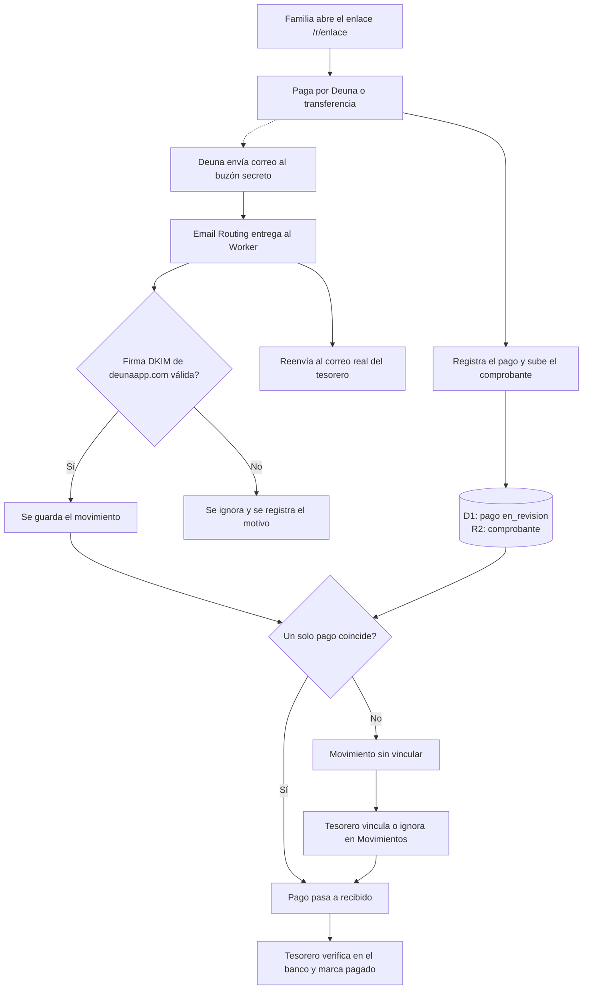

<p align="center">
  <picture>
    <source media="(prefers-color-scheme: dark)" srcset=".github/assets/logo-dark.svg">
    
  </picture>
</p>

<p align="center">
  <strong>Recaudaciones escolares sin cuadernos, sin capturas perdidas en WhatsApp y sin dolores de cabeza</strong> 🎒💸
</p>

<p align="center">
  <a href="https://rekauda.app">rekauda.app</a> ·
  <a href="docs/DESPLIEGUE-CLOUDFLARE.md">Instálala en tu colegio</a> ·
  <a href="docs/OPERACION.md">Guía de tesorería</a> ·
  <a href="LICENSE">MIT</a>
</p>

---

## 👋 ¿Qué es Rekauda?

¿Eres tesorero o tesorera del curso y cada evento termina en un mar de capturas de transferencias por WhatsApp? 😵‍💫 **Rekauda** es una app web para que un curso, una clase o un comité de padres en Ecuador cobre aportes escolares (🎭 vestuario, 🚌 viajes, 🎁 regalos) por transferencia o **Deuna**, con comprobante, tablero público de avance y un panel de tesorería.

Cada curso despliega **su propia copia en su propia cuenta de Cloudflare** ☁️, así que los datos de los pagos no pasan por ningún tercero. Está pensada para tesoreros y padres con algo de ayuda técnica, y para desarrolladores que quieran adaptarla.

> 🏫 Nació para un curso de bachillerato en Ecuador y ahora es **open source** para todos los colegios del país.

## ✨ Qué incluye

| | Función | Qué hace |
| --- | --- | --- |
| 🗂️ | Recaudaciones múltiples | Cada una con sus opciones y precios, fecha límite, color, portada y enlace propio (`/r/<enlace>`) |
| 🧾 | Registro de pago | La familia indica estudiantes, monto, banco y fecha, y adjunta el comprobante (JPG, PNG, WEBP o PDF, máximo 5 MB) |
| 🔎 | Código de seguimiento | Formato `XXX-XXX`; la familia consulta el estado sin crear cuenta |
| 📊 | Tablero público | Estudiantes registrados y pagados, solo con primer nombre e inicial del apellido |
| 🛠️ | Panel de tesorería (`/admin`) | Revisión de pagos, estados, recaudaciones, portadas y movimientos bancarios |
| 🤖 | Confirmación automática | Los correos "¡Recibiste $X en tu cuenta Deuna!" se verifican, se registran y se vinculan al pago correcto |
| 💬 | Vista previa al compartir | Tarjeta de imagen generada para WhatsApp, Telegram y similares |
| 📈 | Analíticas | Google Analytics 4 solo con consentimiento y Cloudflare Web Analytics sin cookies |

## 🔄 Cómo funciona



> 🛡️ **La automatización nunca marca un pago como `pagado`.** Solo la persona de tesorería lo hace, después de ver el dinero en el banco.

## 🚦 Estados de un pago

| Estado | Quién lo asigna | Significado |
| --- | --- | --- |
| 🟡 `en_revision` | La familia (formulario) | Registrado, con comprobante pendiente de revisión |
| 🔵 `recibido` | Tesorería, scripts de revisión o la confirmación automática de Deuna | El comprobante parece válido o hay un movimiento de Deuna vinculado |
| 🔴 `observado` | Tesorería o scripts de revisión | Hay un problema; la nota se muestra a la familia al consultar su código |
| 🟢 `pagado` | Solo tesorería (`/admin`) | Confirmado en el estado de cuenta del banco |
| ⚫ `anulado` | Solo tesorería | Duplicado o spam; no aparece en el tablero público |

Estados de una recaudación: `abierta` (acepta pagos), `cerrada` (visible, sin pagos nuevos) y `archivada` (oculta, responde 404).

## 🚀 Inicio rápido para desarrolladores

Requisitos: **Node.js 22+** y **pnpm 9+**.

```bash
pnpm install
```

Los comandos `dev`, `build`, `test`, `typecheck`, `types` y `deploy` ejecutan antes `scripts/ensure-config.mjs`, que crea `rekauda.config.ts` y `wrangler.jsonc` a partir de los archivos de ejemplo si faltan. En local ya funcionan con los valores de ejemplo; para tu instancia real ve a [Personaliza tu instancia](#-personaliza-tu-instancia).

Crea un archivo `.dev.vars` en la raíz (está en `.gitignore`) con valores de prueba. 🔐 Nunca pongas secretos reales en local.

```bash
printf 'ADMIN_PASSWORD=clave-local\nFORWARD_TO=tesoreria@ejemplo.com\n' > .dev.vars
```

```bash
pnpm db:migrate:local
```

```bash
pnpm dev:api
```

En otra terminal:

```bash
pnpm dev:web
```

El Worker responde en `http://localhost:8799` y Vite en su puerto por defecto, con `/api` redirigido al Worker. El panel está en `/admin`.

| Comando | Qué hace |
| --- | --- |
| `pnpm test` | 🧪 Pruebas con Vitest (proyectos `client` y `worker`) |
| `pnpm typecheck` | 🔍 TypeScript del Worker y del cliente |
| `pnpm build` | 📦 Compila a `dist/` |
| `pnpm run deploy` | 🚢 Aplica migraciones remotas, compila y despliega (no uses `pnpm deploy`) |
| `pnpm types` | 🧬 Regenera `worker-configuration.d.ts` desde `wrangler.jsonc` |

## ☁️ Rekauda Cloud (en construcción)

La rama `feat/cloud` prepara una versión multi-curso: un solo Worker, un subdominio por curso y enlaces mágicos para entrar. 🚧 Por ahora corre solo en local y no se publica en ningún lado hasta pasar la [lista de verificación en sandbox](docs/CLOUD-SANDBOX-CHECKLIST.md).

En esta rama los comandos `dev:api`, `db:migrate:local`, `db:migrate:remote`, `types` y `deploy` se niegan a correr (son del piloto, en `main`). Para autoalojar o probar usa los equivalentes `pnpm cloud:migrate:local`, `pnpm cloud:seed:local`, `pnpm cloud:dev` y `pnpm cloud:types`, con `TENANCY` en `single` en `wrangler.cloud.jsonc` para un solo curso. Detalles en [docs/ARQUITECTURA.md](docs/ARQUITECTURA.md#rekauda-cloud-multi-curso).

La guarda de seguridad lee `wrangler.jsonc` y, opcionalmente, `.pilot-resources.json` (ignorado por git, nunca se sube) para rechazar nombres, ids y dominios reales del piloto. Su forma, con valores inventados, está en [docs/CLOUD-SANDBOX-CHECKLIST.md](docs/CLOUD-SANDBOX-CHECKLIST.md#preámbulo-de-seguridad-del-piloto).

## 📚 Documentación

| Documento | Para quién | Contenido |
| --- | --- | --- |
| ☁️ [docs/DESPLIEGUE-CLOUDFLARE.md](docs/DESPLIEGUE-CLOUDFLARE.md) | Quien instala | Instalación desde cero, secretos, dominio y la guía "Personaliza tu instancia" |
| 📬 [docs/CORREO-DEUNA.md](docs/CORREO-DEUNA.md) | Quien instala y tesorería | Confirmación automática por correo de Deuna |
| 🧮 [docs/OPERACION.md](docs/OPERACION.md) | Tesorería | Uso diario, revisión, cierre y borrado de datos |
| ☁️ [docs/CLOUD-SANDBOX-CHECKLIST.md](docs/CLOUD-SANDBOX-CHECKLIST.md) | Quien publique Cloud | Verificaciones en un dominio de pruebas antes de salir a producción |
| 🏗️ [docs/ARQUITECTURA.md](docs/ARQUITECTURA.md) | Desarrolladores | Componentes, rutas, correo, analíticas y modelo de amenazas |
| 🤝 [CONTRIBUTING.md](CONTRIBUTING.md) | Contribuyentes | Pruebas, convenciones y cómo proponer cambios |
| 🎨 [DESIGN.md](DESIGN.md) y [PRODUCT.md](PRODUCT.md) | Diseño y producto | Sistema de diseño y propósito del producto |

## 🔒 Seguridad y privacidad

- 🗄️ Los comprobantes contienen datos bancarios de las familias. Se guardan en un bucket privado de R2 y solo se sirven desde el panel, con sesión de administrador.
- 🧹 Después del evento borra los comprobantes y los datos. Los comandos exactos están en [docs/OPERACION.md](docs/OPERACION.md#después-del-evento-borrar-comprobantes-y-datos).
- 🙈 El tablero público muestra únicamente el primer nombre y la inicial del apellido de cada estudiante.
- 🍪 Google Analytics se carga solo si la persona acepta en "Preferencias de cookies". Si tu instancia lo usa, obtén y documenta el consentimiento conforme a la LOPDP (Ley Orgánica de Protección de Datos Personales). Para desactivarlo por completo, deja `analytics.gaMeasurementId` en `null` en `rekauda.config.ts`.
- 🚫 Si haces un fork público, nunca subas `rekauda.config.ts` ni `wrangler.jsonc` (contienen la cuenta de cobro y los identificadores de tu cuenta de Cloudflare). Ya están en `.gitignore`.
- 🔑 El panel exige contraseña, cookie `HttpOnly` con `SameSite=Strict` y un encabezado `Origin` del mismo sitio en toda mutación.
- 🐛 Si encuentras una vulnerabilidad, no publiques datos sensibles en un issue abierto; contacta primero a quien administra el repositorio.

## 🎨 Personaliza tu instancia

Todo lo que cambia de un curso a otro está en **dos archivos locales** que no se suben a git:

| Archivo | Qué contiene | Plantilla |
| --- | --- | --- |
| `rekauda.config.ts` | Colegio, curso, cuenta de cobro, bancos, fecha mínima de transferencia, color por defecto y analíticas | `rekauda.config.example.ts` |
| `wrangler.jsonc` | Cuenta de Cloudflare, nombres e identificadores de D1 y R2, dominio y límites de tasa | `wrangler.example.jsonc` |

Si faltan, `scripts/ensure-config.mjs` los copia desde la plantilla. La guía paso a paso está en [docs/DESPLIEGUE-CLOUDFLARE.md](docs/DESPLIEGUE-CLOUDFLARE.md#5-personaliza-tu-instancia).

### 💾 Respalda tu configuración

`rekauda.config.ts`, `wrangler.jsonc` y la imagen del QR (`public/deuna-qr.png`) no están en git. Guarda una copia en un gestor de contraseñas o en un lugar seguro: si pierdes el computador, tendrías que reconstruirlos.

## 🤝 Contribuir

¡Las contribuciones son bienvenidas! 🙌 Lee [CONTRIBUTING.md](CONTRIBUTING.md). Los cambios se proponen con pull requests y commits convencionales.

## 👨‍💻 Autor

Hecho con 🧠 en Ecuador 🇪🇨 por **[Christian Segovia](https://x.com/danger_cris)** ([@danger_cris](https://x.com/danger_cris)).

¿Lo usas en tu colegio? ¡Cuéntamelo! Me encantará saberlo. 💙

## 📄 Licencia

[MIT](LICENSE) © 2026 Christian Segovia. Puedes usar, copiar, modificar y distribuir Rekauda, incluso con fines comerciales, siempre que conserves el aviso de copyright y la licencia. Se entrega "tal cual", sin garantías.
