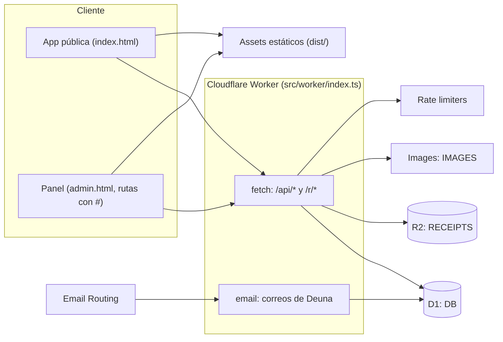
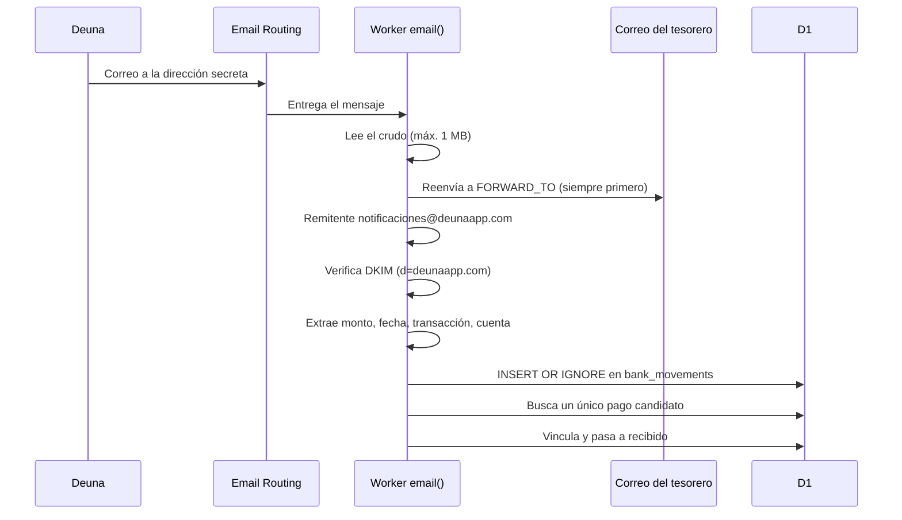

# Arquitectura

Rekauda es un único Cloudflare Worker que sirve la API, genera las vistas previas para compartir, recibe correos de Deuna y entrega la aplicación web como archivos estáticos. Todo el estado vive en una base D1 y un bucket R2 de tu propia cuenta.

Para instalarlo ve a [DESPLIEGUE-CLOUDFLARE.md](DESPLIEGUE-CLOUDFLARE.md). Para el correo de Deuna ve a [CORREO-DEUNA.md](CORREO-DEUNA.md).

## Componentes

| Componente | Binding o ubicación | Uso |
| --- | --- | --- |
| Worker | `src/worker/index.ts` (`fetch` y `email`) | API, vistas previas, correo |
| Assets estáticos | `ASSETS`, carpeta `dist/` | App pública y panel (build de Vite) |
| D1 | `DB` | Tablas `collections`, `payments`, `students`, `bank_movements` |
| R2 | `RECEIPTS` (un solo bucket) | Prefijos `receipts/`, `covers/` y `og/` |
| Images | `IMAGES` | Recodifica la tarjeta de vista previa a JPEG |
| Email Routing | Regla "Send to a Worker" | Entrega los correos de Deuna al handler `email()` |
| Rate limiters | `SUBMIT_LIMITER`, `LOGIN_LIMITER`, `LOOKUP_LIMITER` | Límite por IP y por minuto |
| Secretos | `ADMIN_PASSWORD`, `SESSION_SECRET`, `FORWARD_TO` | Ver `secrets.required` en `wrangler.jsonc` |

### Tablas de D1

| Tabla | Migración | Contenido |
| --- | --- | --- |
| `payments` | `0001_init.sql` (+ `collection_id` en `0002`) | Un registro por comprobante: familia, monto, estado, hash del archivo |
| `students` | `0001`, reconstruida en `0002_collections.sql` | Estudiantes de cada pago, con `option_key` y `option_cents` (precio al registrar) |
| `collections` | `0002`, `0003_collection_theme.sql`, `0004_collection_deuna_link.sql` | Recaudaciones: opciones en JSON, fecha límite, estado, color, portada, enlace de cobro |
| `bank_movements` | `0005_bank_movements.sql` | Transferencias leídas de correos de Deuna; `transaction_number` es único |

`bank_movements` tiene un índice único parcial sobre `payment_id`: un pago se vincula como máximo a un movimiento.

### Prefijos de R2

| Prefijo | Acceso | Contenido |
| --- | --- | --- |
| `receipts/<id>.<ext>` | Privado, solo `GET /api/admin/receipts/:id` con sesión | Comprobantes de pago |
| `covers/<idRecaudación>/<16 hex>.<ext>` | Público, vía `GET /api/covers/...` | Portadas, con nombre derivado del hash del contenido |
| `og/<enlace>/<versión>.jpg` | Público, vía `GET /api/og/<enlace>.jpg` | Tarjetas de vista previa ya renderizadas |

La ruta pública de portadas solo sirve claves que existan como `cover_key` de una recaudación en D1, así que los comprobantes no son alcanzables por ahí.

## Enrutamiento

El Worker corre primero solo para `/api/*` y `/r/*` (`assets.run_worker_first` en `wrangler.jsonc`). Todo lo demás lo sirven los assets, con `html_handling: "drop-trailing-slash"` y `not_found_handling: "single-page-application"`.

| Ruta | Quién responde |
| --- | --- |
| `/api/*` | Worker (`route()` en `src/worker/index.ts`) |
| `/r/<enlace>` | Worker: toma el HTML de la app y le inyecta etiquetas de vista previa |
| `/admin` | Assets (`admin.html`) |
| Cualquier otra ruta no encontrada | Assets: cae en `index.html` (SPA) |

Como una ruta desconocida como `/admin/algo` cae en la app pública, el panel navega solo con el hash: `#resumen`, `#pagos`, `#pagos/<estado|todos>`, `#pago/<id>`, `#eventos`, `#evento/nuevo`, `#evento/<id>` y `#movimientos` (definidas en `src/client/admin/routes.ts`).

Los encabezados de seguridad de los assets están en `public/_headers`. Las respuestas de `/r/*` generadas por el Worker repiten la misma CSP en `src/worker/og.ts`, así que si cambias una, cambia la otra (hay una prueba en `src/worker/csp.test.ts`).

## Contrato compartido

`src/shared/api.ts` define los tipos de la API. Worker y cliente lo importan. Cada respuesta JSON del Worker usa `satisfies` contra esos tipos, de modo que un cambio incompatible rompe `pnpm typecheck`. Regla: se cambia primero el contrato y después los dos lados.

Otros módulos compartidos: `instance-config.ts`, `instance-validation.ts` e `instance.ts` (configuración de cada instancia, descrita abajo), `match.ts` (reglas de vinculación) y `tone.ts` (matemática de color por recaudación).

### Configuración por instancia

Los valores propios de cada curso están en `rekauda.config.ts` (local, fuera de git; plantilla en `rekauda.config.example.ts`). `src/shared/instance-config.ts` define los tipos, `src/shared/instance-validation.ts` aplica reglas que hacen fallar la carga si algo es inválido, y `src/shared/instance.ts` expone los valores ya resueltos al Worker, al cliente y a Vite (que rellena los títulos HTML con marcadores `%REKAUDA_*%`). `scripts/ensure-config.mjs` crea los archivos locales desde las plantillas cuando faltan. Las pruebas usan siempre la plantilla de ejemplo mediante un alias de Vitest.

## API pública

| Método y ruta | Uso |
| --- | --- |
| `GET /api/config` | Nombre del curso y colegio, bancos, cuenta de cobro (caché 5 min) |
| `GET /api/collections` | Recaudaciones visibles (sin archivadas) |
| `GET /api/collections/:slug` | Detalle de una recaudación |
| `GET /api/collections/:slug/board` | Tablero: estudiantes (nombre e inicial) y totales |
| `POST /api/payments` | Registra un pago (multipart con comprobante). Límite `SUBMIT_LIMITER` |
| `GET /api/lookup/:code` | Consulta por código `XXX-XXX`. Límite `LOOKUP_LIMITER` |
| `GET /api/covers/<id>/<hash>.<ext>` | Portada (inmutable) |
| `GET` o `HEAD /api/og/<slug>.jpg` | Tarjeta de vista previa (también `.png` en la ruta) |
| `GET /r/<slug>` | Aplicación con etiquetas de vista previa |

Protecciones de `POST /api/payments`: campo señuelo `hp_c9x` (los bots reciben un éxito falso), consentimiento obligatorio, tope de 150 pagos activos por recaudación, validación de tipo de archivo por bytes iniciales (JPEG, PNG, WEBP, PDF), máximo 5 MB, y los duplicados de archivo o de referencia se aceptan pero se marcan para revisión.

## API de administración

Todas bajo `/api/admin/*`. Si falta `ADMIN_PASSWORD` o `SESSION_SECRET` responde 503 `admin_disabled`. Las mutaciones (todo lo que no sea `GET`, `HEAD` u `OPTIONS`) exigen `Origin` igual al del sitio, antes que cualquier otra comprobación.

| Método y ruta | Uso |
| --- | --- |
| `POST /api/admin/login` | Contraseña; devuelve cookie firmada. Límite `LOGIN_LIMITER` |
| `POST /api/admin/logout` | Cierra sesión |
| `GET /api/admin/session` | 200 si hay sesión válida |
| `GET /api/admin/payments?collection=<id>` | Lista de pagos con banderas (`amountMismatch`, `duplicateReceipt`, `duplicateReference`) |
| `POST /api/admin/payments/:id/status` | Cambia el estado; `observado` y `anulado` exigen nota |
| `GET /api/admin/receipts/:id` | Descarga el comprobante (imágenes en línea, PDF como descarga) |
| `GET` y `POST /api/admin/collections` | Lista y crea recaudaciones |
| `POST /api/admin/collections/:id` | Actualización parcial |
| `POST` y `DELETE /api/admin/collections/:id/cover` | Sube o quita la portada |
| `GET /api/admin/movements?status=unmatched\|all` | Movimientos (hasta 200) |
| `POST /api/admin/movements/import` | Importa un `.eml` de Deuna |
| `POST /api/admin/movements/:id/link` | Vincula a un pago (`{ "paymentId": "..." }`) |
| `POST /api/admin/movements/:id/unlink` | Desvincula; el pago conserva su estado |
| `POST /api/admin/movements/:id/ignore` | Marca el movimiento como ignorado |

La sesión es una cookie `adm` con `HttpOnly`, `Secure`, `SameSite=Strict` y `Path=/api/admin`, que contiene la expiración y una firma HMAC-SHA256 con `SESSION_SECRET`. Dura 6 horas. La contraseña se compara con una función de tiempo constante.

## Vistas previas para compartir (OG)

1. `GET /r/<slug>` pide la app a `ASSETS` y, si la recaudación es pública, reescribe con `HTMLRewriter` el `<title>`, la descripción, `og:*` y `twitter:card`. Los valores se escapan para HTML. Respuesta con `Cache-Control: no-cache`.
2. `og:image` apunta a `/api/og/<slug>.jpg?v=<versión>`. La versión combina la versión del diseño de la tarjeta (`og-card.ts`) y la última modificación de la recaudación, así que WhatsApp, que cachea fuerte, ve una URL nueva cuando algo cambia.
3. `serveOgImage` busca `og/<slug>/<versión>.jpg` en R2. Si no existe, dibuja la tarjeta con Satori y resvg (`@cf-wasm/og`, fuentes Geist incluidas en el bundle por la regla `rules` de `.ttf`), la recodifica a JPEG con el binding `IMAGES` y la guarda en R2. Después borra las versiones viejas de ese enlace.
4. Si el binding `IMAGES` falla, se responde el PNG sin guardarlo, para reintentar en la siguiente solicitud.
5. Caché: la URL con la versión vigente es `immutable` por un año; cualquier otra versión se cachea 5 minutos. R2 se usa en vez de la Cache API porque esta no hace nada en `workers.dev`.
6. Las portadas WEBP no se pueden decodificar en la tarjeta; en ese caso la tarjeta usa solo el color.

## Analíticas

| Herramienta | Cuándo carga | Datos |
| --- | --- | --- |
| Google Analytics 4 | Solo en la app pública y solo tras aceptar el aviso | Páginas vistas y eventos sin datos personales |
| Cloudflare Web Analytics | Baliza sin cookies que Cloudflare inyecta en el sitio | Visitas agregadas |
| Panel de administración | Nunca | Su CSP no permite ninguna de las dos |

- El ID de GA4 es `analytics.gaMeasurementId` de `rekauda.config.ts` (lo lee `src/client/public/lib/analytics/config.ts`). Con `null`, las analíticas quedan apagadas por completo: no aparece el aviso, ni el botón del pie, ni se carga nada.
- Se usa Consent Mode v2 con todo denegado por defecto. Al aceptar solo se concede `analytics_storage`. Al rechazar o retirar el consentimiento se desactiva el ID y se borran las cookies `_ga*`.
- La elección se guarda en el navegador (`rec-analytics-consent`, con versión). Subir `CONSENT_VERSION` vuelve a preguntar a todos.
- Eventos permitidos (`events.ts`): `pay_step_view`, `deuna_click`, `payment_submitted`, `payment_failed`, `status_lookup`, `share_click`. Una lista de claves permitidas descarta cualquier parámetro extra. Nunca se envían nombres, teléfonos, códigos, montos ni datos del comprobante.
- La CSP pública (`public/_headers`) permite `googletagmanager.com`, `google-analytics.com`, `static.cloudflareinsights.com` y `cloudflareinsights.com`.

## Pipeline del correo de Deuna

Código en `src/worker/email/`. Puntos de diseño:

1. **Reenviar primero.** El mensaje se lee a memoria y luego se reenvía a `FORWARD_TO`, pase lo que pase con el análisis. Un error al reenviar se registra y no detiene el proceso. Si el análisis falla, el tesorero igual tiene el correo.
2. **DKIM dentro del Worker.** El remitente `From` se falsifica con facilidad y Deuna publica DMARC con política `p=none`, por lo que los receptores no rechazan los correos falsos. Por eso el Worker verifica por sí mismo que el mensaje esté firmado por `deunaapp.com`. El verificador (`dkim.ts`) acepta solo `rsa-sha256`, rechaza `l=`, exige que `d=` sea exactamente `deunaapp.com` y que `From` esté firmado, rechaza mensajes con más de un `From`, respeta `x=` y obtiene la clave pública por DNS sobre HTTPS de Cloudflare con dos reintentos. Los correos de Deuna salen por Amazon SES, que pliega los tags de `DKIM-Signature` en varias líneas, por lo que el verificador recorta el espacio de plegado. Pasa si al menos una de hasta cinco firmas es válida. No evalúa DMARC ni SPF.
3. **Análisis por etiquetas** (`deuna.ts`). Se aplana el texto, se ignoran tildes solo para comparar y cada valor es lo que hay entre su etiqueta y la siguiente. Exige el encabezado "Detalles de tu pago", que la frase inicial "Recibiste $X de NOMBRE con Deuna" coincida con la tabla, y número de transacción de 6 a 20 dígitos. La fecha del correo se interpreta como hora de Ecuador (UTC-5).
4. **Cuenta de destino.** Los últimos 4 dígitos de la cuenta destino del correo deben coincidir con `treasury.accountNumber` de `rekauda.config.ts`. Si no, se ignora con `wrong_account`.
5. **Idempotencia.** `INSERT OR IGNORE` sobre `transaction_number` (único). El mismo correo entregado dos veces se guarda una sola vez.
6. **Vinculación** (`auto-link.ts` y `src/shared/match.ts`), en ambos órdenes de llegada: correo después del registro, o registro después del correo.

### Reglas de vinculación, a alto nivel

| Regla | Detalle |
| --- | --- |
| Candidatos | Pagos `en_revision`, `recibido` u `observado`, creados en los últimos 45 días, con el mismo monto en centavos y sin movimiento vinculado |
| Ventana de fecha | El movimiento puede llegar de 1 día antes a 2 días después de la fecha declarada por la familia (calendario de Ecuador) |
| Puntaje | Monto 0,20, fecha 0,25 (mismo día) o 0,15 (cerca), nombre hasta 0,45, banco de origen hasta 0,10 |
| Nombre | Compara al ordenante con el representante y con los apellidos de los estudiantes; una sola coincidencia es evidencia débil y nunca vincula sola |
| Umbral | Se vincula solo si hay al menos 2 coincidencias de nombre y el puntaje sin el bono del banco llega a 0,60 |
| Ambigüedad | Si otro candidato también califica o queda a menos de 0,15 de diferencia, no se vincula y queda para tesorería |

### Efectos sobre los estados

- La vinculación pasa un pago `en_revision` u `observado` a `recibido`, con la nota "Confirmado por notificación de Deuna (transacción ...)" y `reviewed_by = 'deuna'`.
- **Nunca** pasa un pago a `pagado`. Solo tesorería lo hace.
- La vinculación manual también acepta pagos `pagado`, sin modificarlos. Un pago `anulado` nunca se vincula.
- Desvincular no cambia el estado del pago.
- La actualización es una sola transacción (`DB.batch`) que vuelve a comprobar el estado, de modo que dos procesos en carrera no pueden dejar datos inconsistentes.

Los motivos y eventos de registro están en [CORREO-DEUNA.md](CORREO-DEUNA.md#solución-de-problemas).

## Resumen del modelo de amenazas

| Amenaza | Mitigación |
| --- | --- |
| Correo falso que simula ser Deuna | Firma DKIM de `deunaapp.com` obligatoria, remitente exacto, dirección de entrada secreta, y la automatización nunca marca `pagado` |
| Acceso al panel por fuerza bruta | Límite de 5 intentos por minuto por IP, comparación en tiempo constante, sesión de 6 horas |
| Petición entre sitios al panel (CSRF) | Cookie `SameSite=Strict` y `Origin` obligatorio en toda mutación |
| Subida de archivos maliciosos | Tipo por bytes iniciales, máximo 5 MB, comprobantes servidos con CSP `sandbox` y los PDF como descarga |
| Filtración de comprobantes | Bucket privado, lectura solo con sesión; la ruta pública de portadas valida contra D1 |
| Spam en el registro | Límite de 10 envíos por minuto por IP, campo señuelo, tope de 150 pagos activos por recaudación |
| Enumeración de códigos | Alfabeto sin caracteres ambiguos y límite de 20 consultas por minuto por IP |
| Datos personales en registros | Los registros no incluyen el correo de reenvío; los datos del ordenante solo quedan en D1 |
| Seguimiento no consentido | Google Analytics solo con aceptación; el panel nunca carga analíticas |
| Datos que sobreviven al evento | Procedimiento de borrado en [OPERACION.md](OPERACION.md#después-del-evento-borrar-comprobantes-y-datos) |

Riesgos que asume el diseño: quien tenga la contraseña del panel ve todos los comprobantes; los límites de tasa son por IP y pueden afectar a familias detrás de la misma red; y la protección de la dirección secreta de Deuna depende de no divulgarla.
