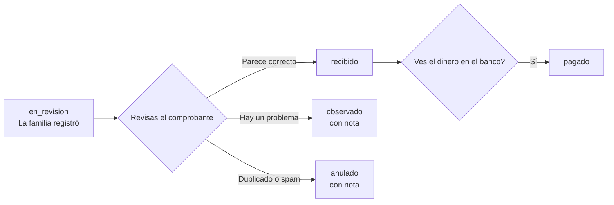

# Operación diaria para tesorería

Guía para la persona que cobra y confirma los pagos. No necesitas programar, salvo en dos momentos: los scripts de revisión (opcionales) y el borrado de datos al terminar el evento, que piden una terminal. Si no manejas la terminal, pide ayuda a quien instaló el sitio.

El panel está en `https://tu-dominio.ec/admin`. Las pestañas son **Resumen**, **Pagos**, **Movimientos** y **Eventos** (las recaudaciones).

## Ciclo de un pago



| Estado | Qué significa para ti |
| --- | --- |
| `en_revision` | Nuevo. Falta revisar el comprobante |
| `recibido` | El comprobante parece correcto, o un correo de Deuna coincidió con el pago. Todavía no está confirmado en el banco |
| `observado` | Algo no cuadra. La nota que escribes se muestra a la familia cuando consulta su código |
| `pagado` | Lo confirmaste en el estado de cuenta. Solo tú puedes marcarlo; ningún proceso automático lo hace |
| `anulado` | Duplicado o spam. No aparece en el tablero público. La nota es obligatoria |

## Crear una recaudación

**Eventos**, **Nueva recaudación**. Campos:

| Campo | Regla |
| --- | --- |
| Enlace (slug) | 3 a 48 caracteres: minúsculas, números y guiones. Forma la dirección `/r/<enlace>`. Cámbialo con cuidado: los enlaces ya compartidos dejarán de funcionar |
| Título | 3 a 80 caracteres |
| Etiqueta (eyebrow) | Opcional, hasta 40 caracteres. Aparece sobre el título |
| Descripción | 10 a 400 caracteres. Se usa también en la vista previa de WhatsApp |
| Notas | Hasta 6, de máximo 200 caracteres cada una |
| Opciones | De 1 a 6. Cada una tiene código (minúsculas, números y guiones, hasta 24), nombre (2 a 60), detalle opcional y precio de USD 1,00 a USD 1000,00 |
| Fecha límite | Se muestra a las familias con cuenta regresiva. **No cierra la recaudación sola** (ver más abajo) |
| Máximo por comprobante | De 1 a 6 estudiantes por registro |
| Color | `#RRGGBB`. Define botones, barras y la tarjeta de vista previa |
| Portada | Imagen JPG, PNG o WEBP de hasta 5 MB. La tarjeta de vista previa solo usa portadas JPG o PNG; con WEBP muestra solo el color |
| Link de cobro de Deuna | Opcional. Debe empezar con `https://pagar.deuna.app/` |
| Vence el | Último día en que se ofrece el link de cobro (calendario de Ecuador). Después de esa fecha el link deja de mostrarse |

Notas importantes:

- Una opción que ya tiene estudiantes registrados no se puede quitar, porque su código los identifica. Cada estudiante guarda el precio al momento de registrarse: cambiar un precio no altera los pagos anteriores.
- Un link de cobro de Deuna suele ser por un monto exacto. Si tu recaudación tiene opciones con precios distintos, es mejor no poner link y dejar que paguen por transferencia o por el QR.
- Hay un tope de 150 pagos activos (no anulados) por recaudación. Al llegar, el formulario responde que el registro está temporalmente cerrado.

## Estados de una recaudación

| Estado | Efecto público |
| --- | --- |
| `abierta` | Visible y acepta pagos |
| `cerrada` | Visible, pero no acepta pagos nuevos |
| `archivada` | Oculta: no aparece en la lista y su enlace da error 404. No acepta pagos |

En **Eventos** usa **Cerrar**, **Reabrir** o **Archivar**. La fecha límite es informativa: cuando pase, debes **cerrar** tú la recaudación.

## Compartir el enlace

1. Copia la dirección `https://tu-dominio.ec/r/<enlace>`.
2. Pégala en WhatsApp. Se mostrará una tarjeta con el título, el precio, la fecha límite y la portada.
3. Si cambias el título, el precio, la fecha, el color o la portada, la tarjeta se actualiza sola, pero WhatsApp guarda en memoria lo que ya vio de un enlace. Para forzar una vista previa nueva añade al final cualquier parámetro, por ejemplo `?v=2`. Suele funcionar, aunque depende de WhatsApp.

## Revisar pagos

En **Pagos**, la lista abre por defecto en `en_revision`. Para cada pago:

1. Abre el comprobante (las imágenes se ven en el panel; los PDF se descargan).
2. Compara monto, fecha y cuenta de destino con lo que registró la familia.
3. Mira las banderas: monto distinto del esperado, comprobante repetido (mismo archivo) o referencia repetida.
4. Elige el estado:
   - `recibido` si parece correcto.
   - `observado` con una nota clara para la familia, por ejemplo "El comprobante muestra USD 10,00; faltan USD 4,00".
   - `anulado` con nota, si es duplicado o spam.
5. Cuando veas el dinero en tu estado de cuenta, marca `pagado`.

Al registrar, la familia recibe un código `XXX-XXX` para consultar el estado en la página principal. Si se equivoca, puede volver a registrar.

### Revisión asistida con scripts (opcional)

Para revisar muchos comprobantes a la vez hay dos scripts de terminal. Requieren que hayas ejecutado `wrangler login` y tener `jq` instalado, y tu `wrangler.jsonc` completo (ver [DESPLIEGUE-CLOUDFLARE.md](DESPLIEGUE-CLOUDFLARE.md#5-personaliza-tu-instancia)). Usan el binding `DB` de D1 y leen el nombre del bucket de `wrangler.jsonc`, así que no hay nombres que editar.

Listar lo pendiente y descargar los comprobantes a `receipts-inbox/`:

```bash
scripts/pending.sh
```

Solo una recaudación (con su enlace):

```bash
scripts/pending.sh --collection <enlace>
```

Contra la base local de desarrollo:

```bash
scripts/pending.sh --local
```

Cada comprobante se guarda como `receipts-inbox/<CÓDIGO>.<ext>`. Esa carpeta contiene datos bancarios de las familias y está en `.gitignore`: bórrala al terminar (ver más abajo).

Registrar el resultado de la revisión de un pago:

```bash
scripts/review.sh XXX-XXX recibido "Detalle de lo verificado: banco, monto, fecha, referencia"
```

```bash
scripts/review.sh XXX-XXX observado "Detalle interno" "Mensaje que verá la familia"
```

Reglas del script: el estado debe ser `recibido` u `observado`; `observado` exige el mensaje para la familia; no modifica pagos que ya estén en `pagado` ni en `anulado`; el código debe tener el formato `XXX-XXX`. Añade `--local` como último argumento para usar la base local. Los cambios quedan con `reviewed_by = script`. Marcar `pagado` o `anulado` se hace siempre desde el panel.

## Movimientos (correos de Deuna)

Solo aplica si configuraste [CORREO-DEUNA.md](CORREO-DEUNA.md). En **Movimientos** ves las transferencias que llegaron por correo y no se pudieron asignar solas a un pago.

| Acción | Efecto |
| --- | --- |
| **Vincular** | Asocia el movimiento a un pago (la app propone candidatos con el mismo monto). El pago pasa a `recibido`. Si ya estaba `pagado`, no cambia |
| **Ignorar** | Descarta el movimiento (por ejemplo, una transferencia que no es de esta recaudación) |
| **Desvincular** | Separa el movimiento del pago. El pago conserva su estado |
| **Importar correo de Deuna (.eml)** | Carga a mano un correo que no llegó. En Gmail: abrir el correo, menú de tres puntos, Descargar mensaje |

Vincular un pago solo lo pasa a `recibido`. Tú lo marcas `pagado` después de ver el dinero en el banco.

## Cierre del evento

1. Cuando termine el plazo, **cierra** la recaudación en **Eventos**.
2. Revisa en **Pagos** (filtro `observado` y `en_revision`) que no queden pendientes.
3. Compara en tu estado de cuenta el total de **Resumen** con lo recibido y marca `pagado` lo que falte.
4. Anota o exporta lo que necesites para tus informes antes de borrar nada.
5. Cuando ya no necesites que sea visible, **archívala**.

## Después del evento: borrar comprobantes y datos

Los comprobantes contienen datos bancarios de las familias. Bórralos cuando termine el evento. Esta acción **no se puede deshacer**: guarda antes lo que necesites.

En los comandos, `DB` es el binding de D1 (no hay que cambiarlo). Reemplaza `NOMBRE_BUCKET` por el nombre de tu bucket R2 y `NOMBRE_DB` por el nombre de tu base D1 (`bucket_name` y `database_name` en `wrangler.jsonc`).

### 1. Borrar los archivos locales de revisión

```bash
rm -rf receipts-inbox
```

### 2. Borrar los comprobantes del bucket R2

Las claves de los comprobantes están en la base de datos. Este comando las lee y borra cada objeto:

```bash
pnpm exec wrangler d1 execute DB --remote --json --command "SELECT receipt_key FROM payments" | jq -r '.[0].results[].receipt_key' | while read -r key; do pnpm exec wrangler r2 object delete "NOMBRE_BUCKET/$key" --remote; done
```

Las portadas (`covers/`) y las tarjetas de vista previa (`og/`) no tienen datos personales. Si también quieres limpiarlas, las portadas se borran desde **Eventos** (quitar portada) y las tarjetas se regeneran solas cuando se piden.

### 3. Borrar los datos de la base

El orden importa porque unas tablas dependen de otras:

```bash
pnpm exec wrangler d1 execute DB --remote --command "DELETE FROM bank_movements; DELETE FROM students; DELETE FROM payments;"
```

Esto deja las recaudaciones (sin datos de familias).

### 4. Comprobar

```bash
pnpm exec wrangler d1 execute DB --remote --command "SELECT (SELECT count(*) FROM payments) AS pagos, (SELECT count(*) FROM students) AS estudiantes, (SELECT count(*) FROM bank_movements) AS movimientos;"
```

Los tres valores deben ser `0`.

### 5. Cierre total (opcional)

Si no vas a reutilizar la instancia, elimina los recursos. El bucket debe estar vacío para poder borrarlo; si quedan objetos en `covers/` u `og/`, vacíalo desde el panel de R2 (por ejemplo con una regla de ciclo de vida que elimine objetos al día siguiente) y vuelve a intentar.

```bash
pnpm exec wrangler r2 bucket delete NOMBRE_BUCKET
```

```bash
pnpm exec wrangler d1 delete NOMBRE_DB
```

```bash
pnpm exec wrangler delete
```

Si usabas la confirmación por correo: elimina la regla de Email Routing y cambia en la app de Deuna el correo de la cuenta de nuevo al tuyo. Los registros del Worker (Observability) contienen números de transacción y montos; se conservan según la retención de tu cuenta de Cloudflare.

## Dónde mirar las analíticas

| Herramienta | Dónde | Qué ves |
| --- | --- | --- |
| Google Analytics 4 | Tu propiedad en analytics.google.com: **Informes**, **Tiempo real** y **Eventos** | Visitas a la página pública (solo de quien aceptó cookies) y eventos: `pay_step_view`, `deuna_click`, `payment_submitted`, `payment_failed`, `status_lookup`, `share_click` |
| Cloudflare Web Analytics | Panel de Cloudflare, sección **Analytics & Logs**, **Web Analytics** | Visitas agregadas, sin cookies |

Los eventos nunca incluyen nombres, teléfonos, códigos de seguimiento ni montos. El panel `/admin` no carga ninguna analítica. Los nombres de menús pueden cambiar si Google o Cloudflare actualizan sus paneles.

## Problemas frecuentes

| Síntoma | Qué revisar |
| --- | --- |
| No puedo entrar al panel | Contraseña (`ADMIN_PASSWORD`); tras 5 intentos fallidos en un minuto hay que esperar. Si ves "no está configurado", faltan secretos |
| La sesión se cierra sola | Dura 7 días desde que ingresas; vuelve a ingresar |
| Cambié `ADMIN_PASSWORD` y quiero cerrar otras sesiones | Después de cambiarla, ingresa de nuevo con la clave nueva: eso cierra todas las demás sesiones abiertas |
| La familia dice que el registro está cerrado | La recaudación está `cerrada`, o llegó al tope de 150 pagos activos |
| Un pago llegó duplicado | Mira las banderas de comprobante o referencia repetida y anula el duplicado con nota |
| No aparece el QR | Falta el archivo `public/deuna-qr.png` (no está en git) o `treasury.qrUrl` apunta a otro archivo, o está en `null` |
| La vista previa de WhatsApp está desactualizada | Ver "Compartir el enlace" |
| El correo de Deuna no se asigna | Ver [CORREO-DEUNA.md](CORREO-DEUNA.md#solución-de-problemas) |
